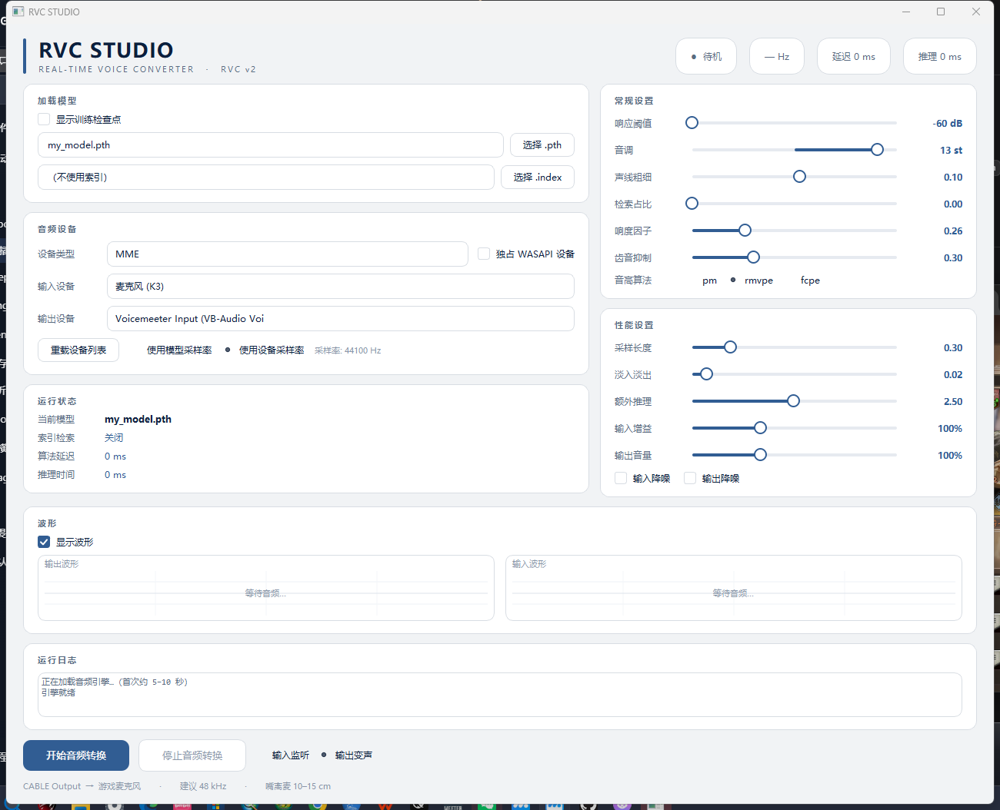

# RVC Studio

实时变声的桌面客户端，基于 [RVC](https://github.com/RVC-Project/Retrieval-based-Voice-Conversion-WebUI) 的推理引擎，界面用 PySide6 重写。

> 本仓库**只包含界面与实时推理引擎**，不附带 RVC 本体、预训练模型或任何声音模型。

## 这个仓库是什么 / 不是什么

| | |
|---|---|
| ✅ 包含 | PySide6 界面 + 实时变声引擎（rvc_engine.py，含音频回调、推理循环、音高提取、索引检索） |
| ❌ 不包含 | RVC 本体代码（infer/、tools/、configs/）、HuBERT/RMVPE 预训练模型、.pth 声音模型、.index 索引 |
| 运行方式 | 放进已安装好的 RVC 根目录里运行，不是独立 exe |



## 特性

- 模型 / 索引选择，支持过滤训练检查点
- 音频设备枚举，自动匹配常用设备
- 实时波形（可开关，自适应增益）
- 输入监听 / 输出变声即时切换
- 参数热更新：音调、声线、检索占比、响度、齿音
- 输入增益 / 输出音量
- 记住上次选择
- 运行日志、崩溃日志

## 环境要求

- Windows
- 已安装好的 RVC 运行环境（Python 3.10+，含 torch、librosa、sounddevice、faiss）
- PySide6：`pip install PySide6`

## 安装

把两个文件放进 RVC 根目录（和 `assets/`、`configs/`、`runtime/` 同级）：

```
RVC根目录/
├─ assets/weights/          ← 放你的 .pth 模型
├─ configs/                 ← 已存在
├─ runtime/                 ← RVC 自带
├─ rvc_studio_qt.py         ← 本仓库
└─ rvc_engine.py            ← 本仓库
```

然后运行：

```bat
runtime\pythonw.exe -X utf8 rvc_studio_qt.py
```

或者双击 `run.bat`。

## 使用

1. 选择 `.pth` 模型（默认只列最终模型，勾选「显示训练检查点」可查看全部）
2. 选择音频设备（建议 MME 或 WASAPI）
3. 等日志出现「引擎就绪」后点「开始音频转换」
4. 需要看波形时勾选「显示波形」

参数说明：

| 参数 | 说明 | 是否需要重启 |
|---|---|---|
| 音调 | 变调半音数 | 实时 |
| 声线粗细 | formant 偏移 | 实时 |
| 检索占比 | index 检索强度 | 实时 |
| 响度因子 | 响度混合比例 | 实时 |
| 齿音抑制 | de-esser 强度 | 实时 |
| 输入增益 / 输出音量 | 音量倍数 | 实时 |
| 采样长度 / 淡入淡出 / 额外推理 | 缓冲区参数 | **需要重启音频** |

## 免责声明

- 本项目不提供、不分发任何声音模型或音频素材。
- 使用者需自行确保所使用的模型与音频拥有合法授权。
- 请勿将本工具用于冒充他人、侵犯他人声音权益或任何违法用途。
- 因使用本工具产生的法律责任由使用者自行承担。

## 致谢

- [Retrieval-based-Voice-Conversion-WebUI](https://github.com/RVC-Project/Retrieval-based-Voice-Conversion-WebUI) — 推理引擎来源
- [歸藏设计](https://github.com/op7418/dsh-guizang-design) — 界面配色与设计规范参考

## License

MIT，详见 [LICENSE](LICENSE) 与 [NOTICE](NOTICE)。
